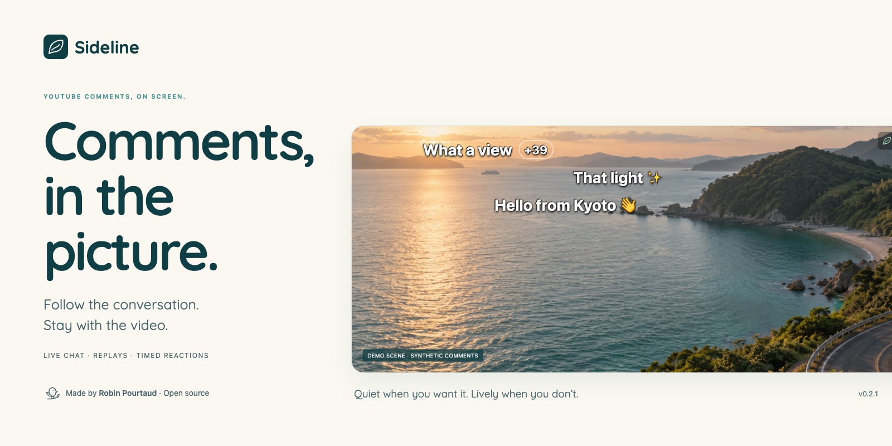
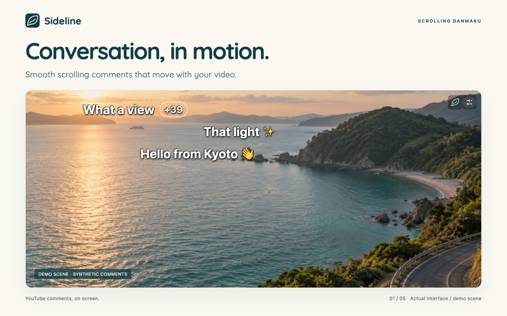
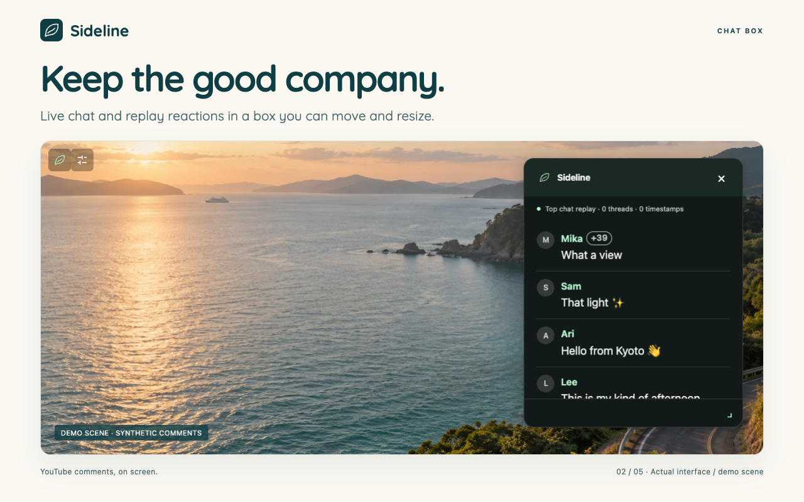
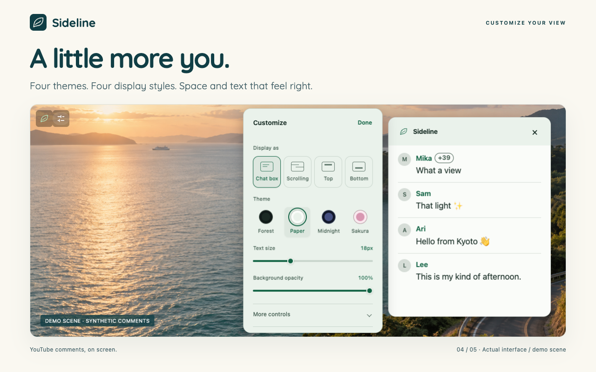

<p align="center">
  
</p>

<p align="center">
  <a href="https://github.com/RobinPourtaud/sideline/releases/latest"></a>
  <a href="https://github.com/RobinPourtaud/sideline/actions/workflows/check.yml"></a>
  <a href="LICENSE"></a>
</p>

# Sideline

**YouTube comments, on screen.**

Follow the conversation while you watch. Sideline brings live chat, replay chat, and timestamped comments into the video, as smooth scrolling danmaku, a movable chat box, or quiet lines at the top or bottom.

A small, local-first extension for desktop Chrome and Firefox. A [Mac Safari development preview](docs/safari.md) is available to build from source. No Sideline account, backend, analytics, or comment uploads.

<p align="center">
  <a href="https://github.com/RobinPourtaud/sideline/releases/latest"><strong>Download v0.2.0</strong></a> ·
  <a href="docs/usage.md">User guide</a> ·
  <a href="https://github.com/RobinPourtaud/sideline/issues">Report a bug</a> ·
  <a href="CONTRIBUTING.md">Contribute</a>
</p>

## The conversation belongs in the picture



- **Four ways to watch.** Scrolling danmaku, chat box, top comments, or bottom comments. Motion follows video pause and playback speed.
- **Less repetition, more room.** Quiet remembers matching chat for 60 seconds; Balanced groups five-second bursts; Lively keeps messages separate. Forty matching greetings become one **Hello +39**. Matching ignores case and symbols, and counters update without restarting motion.
- **Reactions at the right moment.** Loaded timestamped comments appear when playback reaches their reference, with available like counts. Multiple timestamps in one comment become separate moments.
- **Make it yours.** Forest, Paper, Midnight, and Sakura themes; adjustable text size, opacity, position, scrolling direction, speed, and density.
- **Ten interface languages.** English, French, Spanish, German, Portuguese, Japanese, Korean, Simplified Chinese, Hindi, and Arabic. Optional on-device comment translation in browsers that support it.

<table>
  <tr>
    <td width="50%"></td>
    <td width="50%"></td>
  </tr>
</table>

All captures use the real interface and synthetic comments over an original demonstration scene. They are not live YouTube transcripts.

## Install

Get the browser ZIP from [the latest release](https://github.com/RobinPourtaud/sideline/releases/latest) and extract it.

| Browser | Install from a release |
| --- | --- |
| Chrome / Chromium | Open `chrome://extensions`, enable **Developer mode**, select **Load unpacked**, and choose the extracted Chrome folder. |
| Firefox | Open `about:debugging#/runtime/this-firefox`, select **Load Temporary Add-on**, and choose `manifest.json` in the extracted Firefox folder. This installation lasts until Firefox restarts. |

Store updates are being prepared. The existing [Chrome listing](https://chromewebstore.google.com/detail/sideline/momopedapmmddfbgchhiicmniendfkgk) is currently limited to testers; the GitHub download is available independently. Unsigned Firefox release ZIPs are intended for temporary installation or development, not permanent installation in standard Firefox.

Open or reload a YouTube watch page, then select the **Sideline** icon in the playback controls. The adjacent settings button opens Customize. See the [user guide](docs/usage.md) for controls, repeat handling, fullscreen, translation, and optional comment loading.

## Your comments stay on your device

Preferences use local extension storage. Comments, repeat memory, and translations stay in memory for the current video session. The extension requests **storage** and access to **www.youtube.com** pages, with no broad access to other sites.

Avatars, emoji, and stickers can load from YouTube/Google image servers. Optional comment loading invokes YouTube’s existing loader; optional translation may download browser-provided language packs. [Privacy details →](PRIVACY.md)

Sideline works with comments YouTube has loaded. It does not scan every comment. YouTube’s page structure can change; replies, Shorts, mobile layouts, embedded players, and Safari extension packaging are currently outside the supported scope.

## Built openly, contributions welcome

**About half of Sideline was vibe-coded with AI assistance.** That is part of how it was built, and we are saying it directly. The code is open for inspection and improvement, with automated checks for core behavior, accessibility, and browser integration.

All contributions are welcome: bug reports, code cleanup, translations, design improvements, browser testing, and feature ideas. You do not need a large PR to help. Start with [the contribution guide](CONTRIBUTING.md) or [open an issue](https://github.com/RobinPourtaud/sideline/issues).

## Develop

Use **Node.js 24+**.

```sh
npm ci
npm run dev              # Chrome
npm run dev:firefox      # Firefox
npm run check            # Types, formatting, and unit tests
npm run build
npm run build:firefox
npx playwright install chromium firefox webkit
npm run test:browser
```

`npm run preview:ui` serves the synthetic demo at `http://localhost:5199/tests/fixtures/watch.html`. No YouTube connection is needed for fixture tests.

| Read more | |
| --- | --- |
| [Build and package](BUILDING.md) | Reproduce Chrome, Firefox, and reviewer source archives |
| [Architecture](docs/architecture.md) | Plain TypeScript, DOM adapters, bounded state, and cleanup |
| [Testing](docs/testing.md) | Browser evidence and known validation limits |
| [Security](SECURITY.md) | Report a vulnerability and review the tooling advisory |
| [Collection](docs/collection.md) | What is read and how comment loading works |
| [Changelog](CHANGELOG.md) | What changed in v0.2.0 |

## License

[MIT](LICENSE) · Made by [Robin Pourtaud](https://pourtaud.dev/).

Sideline is an independent project and is not affiliated with YouTube, Google, or Mozilla. Marketing font licensing and asset provenance are recorded alongside the [artwork](docs/assets/v0.2.0/asset-brief.md).
